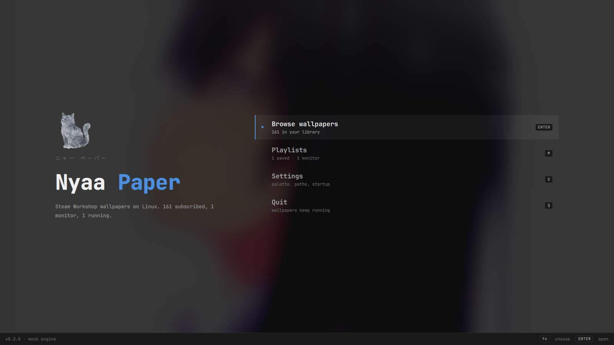
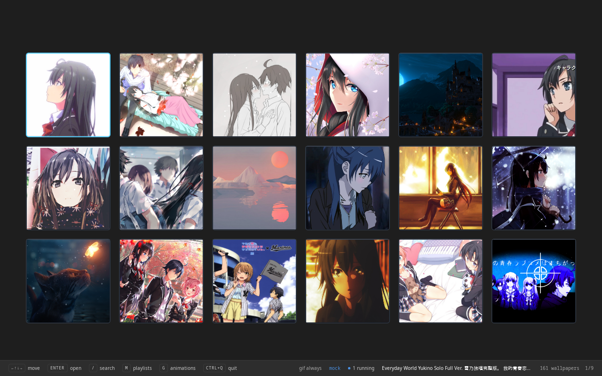
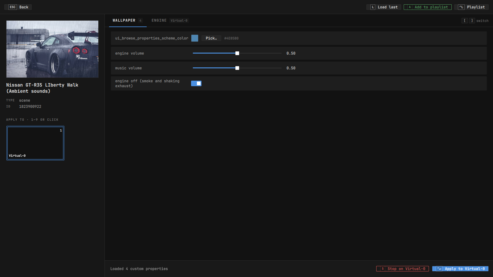
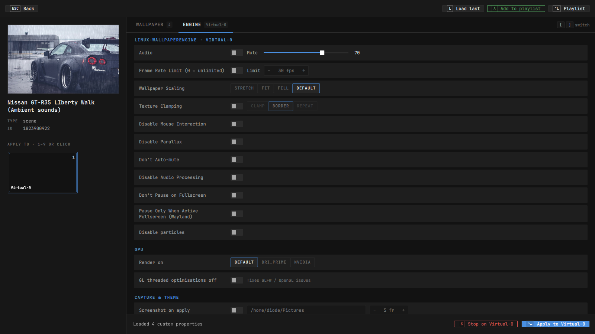
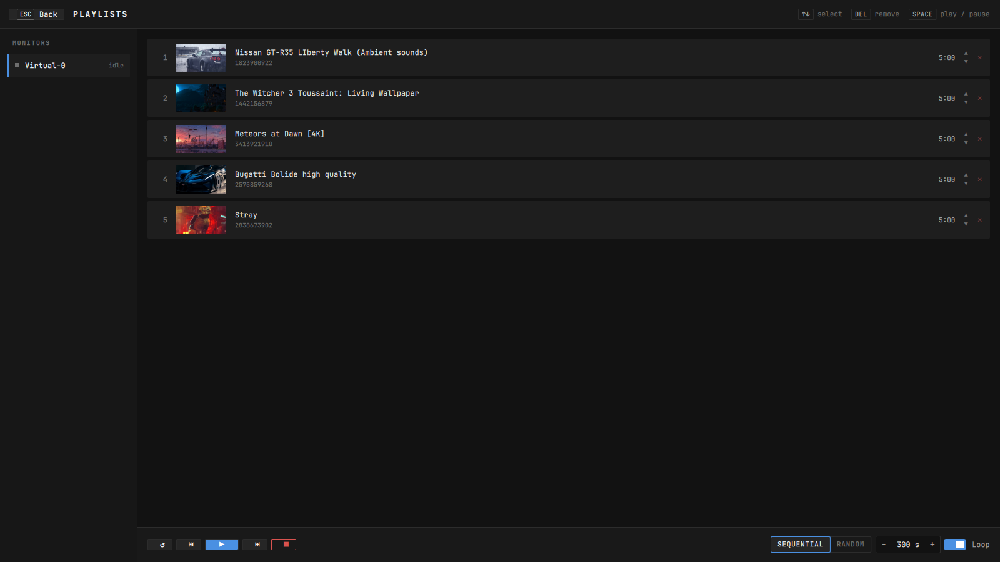
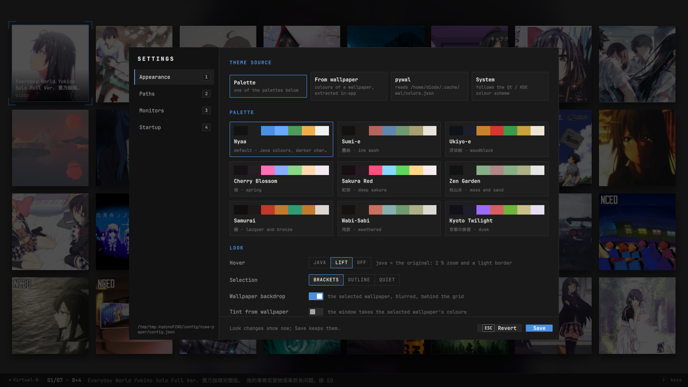

<p align="center">
  
</p>

<h1 align="center">Nyaa Paper</h1>
<p align="center">
  <em>Steam Workshop wallpapers on Linux — per-monitor, per-GPU, playlists, one Flatpak</em>
</p>

<p align="center">
  <a href="LICENSE.txt"></a>
  <a href="https://github.com/diode701/nyaa-paper/releases"></a>
</p>

---

Browse your Wallpaper Engine workshop subscriptions. Tweak each wallpaper's
properties. Give every monitor its own wallpaper, settings and GPU. Build
playlists. Close the window — the wallpapers keep running.

This is the rewrite of the original JavaFX app, which lives on branch `java`:
same design and behaviour, now as two native processes and a Flatpak that
bundles its own engine. No Java, no JVM heap to tune, no host libraries to
install.

```
nyaa-paperd    Rust daemon   owns the wallpaper engines, scans the workshop,
                             runs playlists, keeps going when the window closes
nyaa-paper-qt  C++ / QML     the window: title, library, properties, playlists, settings
```

They talk over D-Bus (`org.nyaa.Paper`; interfaces in `interfaces/*.xml`).
The client builds the complete engine command line; the daemon only starts,
schedules and stops engines. The daemon never needs to know what a wallpaper
property is, and the UI can change without touching it.

Wallpapers are rendered by
[nyaa-wallpaperengine](https://github.com/diode701/nyaa-wallpaperengine), a fork
of [linux-wallpaperengine](https://github.com/Almamu/linux-wallpaperengine) with
the fixes this app needed (audio, web wallpapers, mouse input, Flatpak support).

---

## What it can do

- Run different wallpapers on different screens, each with its own settings and its own GPU
- **Persistence** — settings are saved per monitor *and* per wallpaper on apply. Restore everything on next launch. **Load last** recalls the saved settings of any wallpaper/monitor pair without applying
- **Playlists** — per-monitor, sequential or random, configurable interval, loop toggle. Video wallpapers play to the end of their actual duration
- **Daemon** — closing or crashing the window never stops a wallpaper; reopening the app picks up what is running
- **Keyboard-first** — every view is driven from the keyboard (`?` in the library shows the keys). The mouse works everywhere too
- **Title screen** (skippable) and a library grid sized like the Java one, with animated previews: always, on hover, or off for slow machines
- **Properties** read from each wallpaper's `project.json` — 10 types: booleans, sliders, colours, combos, text, group headers, text inputs, file/directory pickers and scene textures
- **Engine options** per monitor: volume, FPS limit, scaling, clamping, mouse, parallax, audio processing, fullscreen pause, particles
- **GPU per wallpaper**: Default, DRI_PRIME (with device number) or NVIDIA PRIME offload, plus the `__GL_THREADED_OPTIMIZATIONS=0` toggle
- **Screenshot on apply** into a folder you choose, one file per monitor — useful with pywal
- **Themes** — nine palettes, or colours taken from the current wallpaper, from pywal, or from the system theme. Hover style, selection style, backdrop, tint and UI scale are configurable
- **Monitor map** drawn from your real screen layout
- **Tray** with autostart on login (`--tray` starts hidden)
- Newly subscribed wallpapers appear live; unsubscribed ones disappear. Items that are not wallpapers (Wallpaper Engine "Asset" packs) are skipped
- If an engine exits on its own, the status bar says which monitor it was

---

## Screenshots

<p align="center">
  <br>
  <em>Title screen — skippable</em>
</p>

<p align="center">
  <br>
  <em>Library — keyboard-navigated grid with animated previews</em>
</p>

<p align="center">
  <br>
  <em>Properties — the wallpaper author's options, applied per monitor</em>
</p>

<p align="center">
  <br>
  <em>Engine tab — audio, frame rate, scaling, GPU, capture</em>
</p>

<p align="center">
  <br>
  <em>Playlists — per monitor, reorder, interval, sequential or random, loop</em>
</p>

<p align="center">
  <br>
  <em>Settings — palettes, theme source, look, paths, monitors, startup</em>
</p>

A walkthrough of the original Java version, which this port follows:
[demo video](https://www.youtube.com/watch?v=Xi-unn0jWRg).

---

## Install

### Flatpak (any distribution)

Download the bundle from [Releases](https://github.com/diode701/nyaa-paper/releases), then:

```
flatpak install --user ./nyaa-paper-0.3.0-x86_64.flatpak
flatpak run io.github.diode701.NyaaPaper
```

The KDE runtime (`org.kde.Platform` 6.11) comes from Flathub automatically. The
bundle carries everything else, the wallpaper engine included.

**You need:** Wallpaper Engine installed through **Steam** (native Steam). Its
assets are read from your Steam folder at runtime — they are paid content and
are never included in this package.

**Flatpak Steam** is not granted by default yet. Workaround:

```
flatpak override --user --filesystem=~/.var/app/com.valvesoftware.Steam/.local/share/Steam:ro io.github.diode701.NyaaPaper
```

then set the workshop path in Settings → Paths to
`~/.var/app/com.valvesoftware.Steam/.local/share/Steam/steamapps/workshop/content/431960`.

---

## Build from source

```
git clone https://github.com/diode701/nyaa-paper.git
cd nyaa-paper
make daemon && make gui      # cargo build; cmake + ninja in gui/build
make test                    # Rust tests + C++ test suites
```

Needs Rust (stable), Qt 6 (Quick, QuickControls2, DBus, Multimedia), CMake and
Ninja, and a `linux-wallpaperengine` binary (`NYAA_ENGINE=/path/to/binary` or
Settings → Paths).

Run: start `daemon/target/debug/nyaa-paperd`, then `gui/build/nyaa-paper-qt`
(`--tray` starts hidden). `NYAA_MOCK=1` runs the window without a daemon.

The Flatpak, engine included:

```
scripts/flatpak.sh            # build and install for the current user
scripts/flatpak.sh bundle     # ...and write a .flatpak bundle
```

---

## Configuration

Everything lives in `~/.config/nyaa-paper/` (the Flatpak uses the same folder):

| File | What it holds |
|------|---------------|
| `config.json` | paths, look, startup, monitors — everything in Settings |
| `wallpapers.json` | saved settings per monitor and per wallpaper, with the last-applied one marked |
| `playlists/<monitor>.json` | one playlist per monitor |

Main `config.json` fields:

| Field | What it does |
|-------|-------------|
| `paths.workshop` | where your workshop subscriptions live |
| `paths.assets` | Wallpaper Engine's `assets` folder; empty = found automatically |
| `paths.engine` | engine binary; empty = the bundled one |
| `paths.pywal`, `paths.screenshots` | pywal cache; folder for screenshots on apply |
| `startup.persistOnStart` | restore every monitor's last wallpaper and settings when the app starts |
| `startup.autoStartOnBoot` | start in the tray on login |
| `ui.*` | palette, theme source, hover/selection style, backdrop, tint, scale, title screen, extra monitor names |
| `preview.animation` | animated previews: `always`, `hover` or `off` |

A corrupt or missing `config.json` falls back to defaults instead of crashing.

---

## Usage

1. Open the app. The title screen offers Browse, Playlists, Settings, Quit (skip it in Settings).
2. Arrow keys move through the grid; the edges turn the page. `Enter` opens a wallpaper. `/` searches.
3. The properties view has two tabs, switched with `[` `]`: **Wallpaper** (the author's options) and **Engine** (volume, FPS, scaling, GPU, capture…).
4. Pick a monitor on the map (`1`–`9`, `0`, or click). **Load last** (`L`) restores saved settings. `Ctrl+Enter` applies. `A` adds the current setup to that monitor's playlist. `S` stops the wallpaper on that monitor.
5. Playlists (`M`): pick a monitor, reorder or remove entries, set mode, interval and loop, play / pause / next / previous.
6. Close the window. Wallpapers keep running in the daemon; the tray brings the window back.

---

## Keyboard shortcuts

### Title screen

| Key | Action |
|-----|--------|
| `↑` `↓` | Choose |
| `Enter` | Open |
| `M` | Playlists |
| `S` | Settings |
| `Q` | Quit (wallpapers keep running) |

### Library

| Key | Action |
|-----|--------|
| `↑` `↓` `←` `→` | Move; the edges turn the page |
| `N` `P` / `PgUp` `PgDn` | Previous / next page |
| `Enter` | Open properties |
| `/` | Search (`Esc` closes it) |
| `M` | Playlists |
| `S` | Settings |
| `G` | Cycle animated previews: always / hover / off |
| `?` or `H` | Show all keys |
| `Ctrl+Q` | Quit (wallpapers keep running) |

### Properties

| Key | Action |
|-----|--------|
| `[` `]` | Wallpaper / Engine tab |
| `Ctrl+Enter` | Apply to the selected monitor |
| `1`–`9`, `0` | Select monitor 1–10 |
| `Ctrl+↑` `Ctrl+↓` | Previous / next monitor |
| `L` | Load last saved settings for this wallpaper on this monitor |
| `A` | Add to this monitor's playlist |
| `S` | Stop the wallpaper on this monitor |
| `Ctrl+L` | Mini playlist panel |
| `Esc` | Back to the library |

### Mini playlist panel

| Key | Action |
|-----|--------|
| `↑` `↓` | Select entry |
| `Delete` | Remove entry |
| `Space` | Play / pause |
| `N` `P` | Next / previous |

### Playlists

| Key | Action |
|-----|--------|
| `↑` `↓` | Select entry |
| `Delete` | Remove entry |
| `Space` | Play / pause |
| `Esc` or `B` | Back |

### Settings

| Key | Action |
|-----|--------|
| `1`–`4` | Appearance / Paths / Monitors / Startup |
| `Esc` | Revert unsaved changes and close |

---

## GPU notes

| Mode | Environment set for the engine |
|------|-------------------------------|
| Default | nothing |
| DRI_PRIME | `DRI_PRIME=<number>` |
| NVIDIA | `__NV_PRIME_RENDER_OFFLOAD=1`, `__GLX_VENDOR_LIBRARY_NAME=nvidia` |

"GL threaded optimisations off" sets `__GL_THREADED_OPTIMIZATIONS=0` in any
mode; it helps with GLFW/OpenGL start-up crashes on some systems. GPU variables
only work on hybrid graphics: with a MUX hard-wiring the display to one GPU, no
variable can reroute it. NVIDIA is offered when the driver is detected (inside
the Flatpak too).

---

## Property types

`bool` → toggle  
`slider` → slider with value readout  
`color` → colour picker (normalised floats; accepts hex and space-separated values)  
`combo` → dropdown  
`text` → static label (HTML reduced to text)  
`group` → section header  
`textinput` → text field  
`file` / `directory` / `scenetexture` → text field with a picker  
*(no type)* → treated as `text`

Properties keep the author's `order`. Unknown types are skipped; one malformed
property does not break the rest.

---

## Wallpaper layer and compositor overrides

On Wayland the engine draws each wallpaper as a layer-shell surface on the
**background** layer, with the namespace `linux-wallpaperengine`, below panels,
icons and windows. Settings → Paths has a "Wayland layer" option, but it is
**not implemented yet**: the value is saved and not passed to the engine.

To change how the wallpaper is stacked, use your compositor's own rules and
match the namespace `linux-wallpaperengine`:

- **Hyprland:** `layerrule` with `namespace:linux-wallpaperengine`
  (for example to change blur or animations on the wallpaper layer)
- **Sway / other wlroots compositors:** their layer-shell options for the
  `linux-wallpaperengine` namespace
- **KDE Plasma (KWin):** the wallpaper sits under the desktop. If Plasma's own
  desktop wallpaper covers it, set Plasma's wallpaper to a plain or transparent
  one so the engine's surface shows through

On X11 the engine draws on the root window instead; layer rules do not apply.

---

## Troubleshooting

- **A wallpaper does not start** — the status bar names the monitor. Run the engine by hand to see why:
  `flatpak run --command=linux-wallpaperengine io.github.diode701.NyaaPaper --screen-root <output> --bg <workshop-id>`
  (output names: `kscreen-doctor -o`).
- **No sound** — check "Don't auto-mute" on the Engine tab if other audio is playing; some web wallpapers only play sound after you click inside them.
- **Wrong GPU / start-up crash on hybrid graphics** — try DRI_PRIME or NVIDIA, and the GL threaded optimisations toggle.
- Neither the app nor the Flatpak needs `sudo`. Everything lives under `~/.config/nyaa-paper/` and the Flatpak's own folders.

---

## Known issues

- **Presets** (workshop items that only reference another wallpaper) do not start yet
- Some scenes use features the engine does not support yet (light objects, a few script APIs); a few render blank
- Flatpak Steam needs the manual override above
- Screenshots of web and video wallpapers come out black (the library previews are unaffected)

---

## Changelog

See [CHANGELOG.md](CHANGELOG.md) for every release, including the Java app's
history on branch `java`.

---

## Original Java version

The JavaFX app (AUR `nyaa-paper-bin`, pre-compiled JARs) lives on branch
[`java`](https://github.com/diode701/nyaa-paper/tree/java) with its own README
and changelog. This port keeps its design and fixes bugs found along the way:
Load last only remembered the last wallpaper per monitor, an empty library
wiped saved configs and playlists, and a corrupt config crashed start-up.

---

## Credits

diode701 — design, code, upkeep  
[Almamu](https://github.com/Almamu/linux-wallpaperengine) and contributors — linux-wallpaperengine, the engine that does the actual work  
[Gaiser147](https://github.com/Gaiser147) — text rendering and scene compatibility work the engine fork builds on

---

[GNU AGPLv3](LICENSE.txt)

Meow
