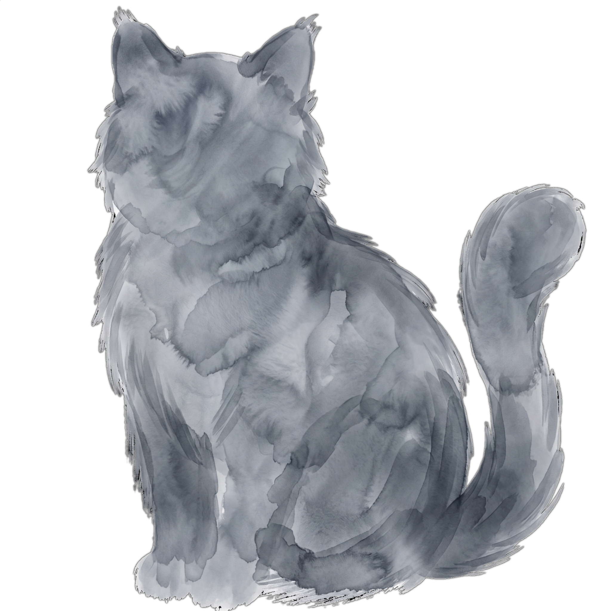
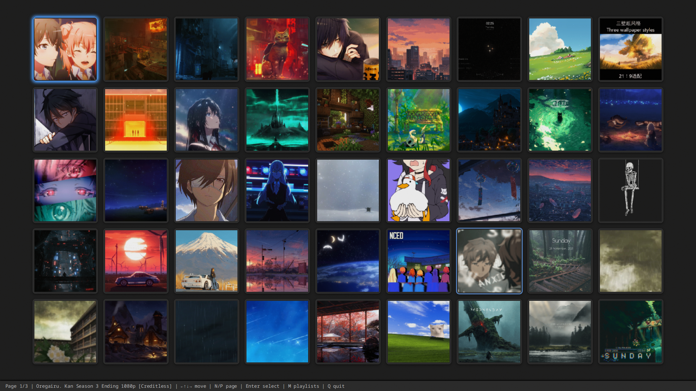
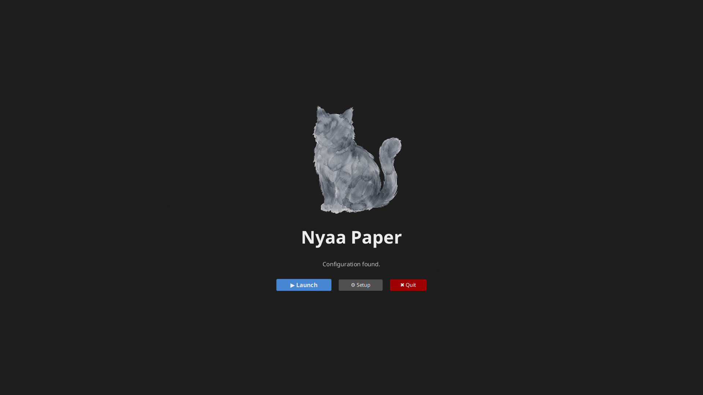
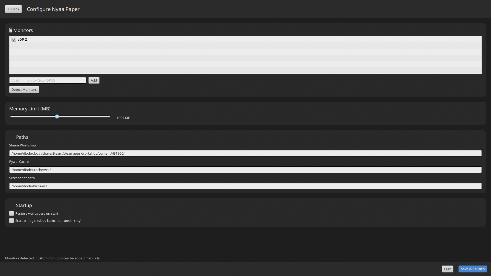
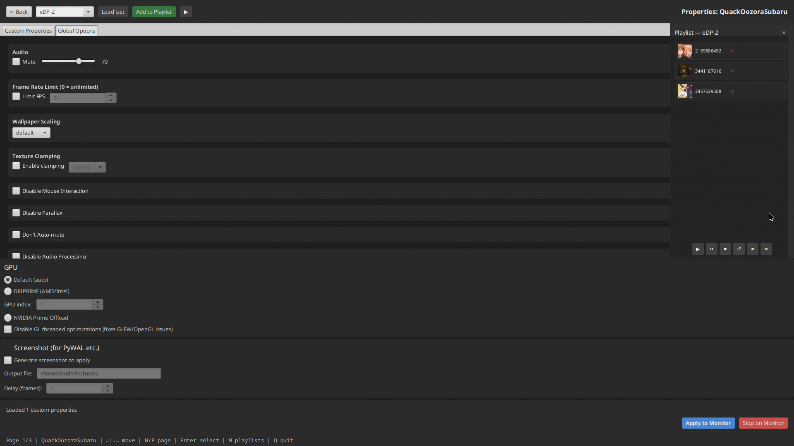
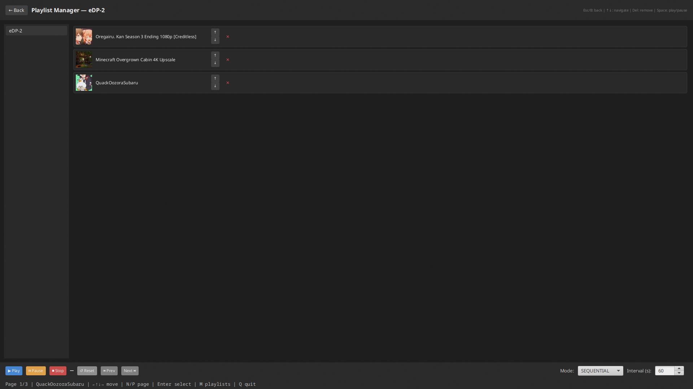

<p align="center">
  
</p>

<h1 align="center">Nyaa Paper</h1>
<p align="center">
  <em>linux-wallpaperengine GUI — per-monitor wallpapers, system tray, playlists, fat JARs</em>
</p>

<p align="center">
  <a href="https://github.com/diode701/nyaa-paper/blob/main/LICENSE"></a>
  <a href="https://aur.archlinux.org/packages/nyaa-paper-bin"></a>
  <a href="https://github.com/diode701/nyaa-paper/releases"></a>
  <a href="https://github.com/diode701/nyaa-paper/actions"></a>
</p>

---

A GUI wrapper around [linux-wallpaperengine](https://github.com/Almamu/linux-wallpaperengine).  
Browse Steam Workshop wallpaper subscriptions. Tweak per-wallpaper properties. Assign to monitors. Build playlists. Close the window — everything keeps running in the tray.

Pre-compiled JARs. No Python. No C build chain. No dependency hell.

---

## What it can do

- Run different wallpapers on different screens, each with its own settings
- **Persistence** — settings auto-save on apply. Restore everything on next launch. A "Load last" button recalls saved settings for any wallpaper/monitor combo without applying
- **Playlists** — per-monitor playlists with sequential or random mode, configurable interval, loop toggle. Timer-based cycling picks up video wallpapers' actual duration via ffprobe so they play to the end
- **Mini playlist panel** — hover-activated slide-out panel in the properties view. Play / pause / stop / next / prev / reset without leaving the screen
- **Full playlist manager** — press `M` in the browser. Reorder, remove, and control playback for every monitor's playlist in one view
- **Keyboard-driven** — every view has keyboard shortcuts. Arrow keys navigate the grid. `Ctrl+Enter` applies, `L` loads saved settings, `A` adds to playlist, `S` stops. Digit keys `1–9,0` jump to monitors. `M` opens the playlist manager. See full reference below
- **Auto-start on login** — toggle in the launcher setup. Writes a `.desktop` autostart entry so the app launches in tray mode when you log in
- GPU choice per wallpaper: Default, DRI_PRIME, or NVIDIA Prime Offload. Plus a toggle to set `__GL_THREADED_OPTIMIZATIONS=0` for machines with GLFW or OpenGL trouble
- Screenshot on launch. Writes `<monitor>_nyaa_sc.png` into whatever directory you pick, so two monitors don't clobber each other. Useful with PyWAL
- System tray lives after you close the browser. Right-click to restore or quit. Clean shutdown stops all wallpaper processes
- Launcher pops up first — set heap size, monitor list, paths, plus toggles for auto-restore and login-start. Skip with `--tray` for headless autostart
- Newly subscribed wallpapers show up live. Unsubscribe and they vanish. Stale configs from unsubscribed wallpapers are auto-pruned
- Parses custom properties from the wallpaper's `project.json`. Handles 10 types: booleans, sliders, colours, combos, text, group headers, text inputs, file/directory pickers, and scene textures. HTML labels get stripped to readable text
- If the engine process crashes, the bottom bar tells you which monitor died so you can reapply. Event-based, no polling

---

## Demo

<p align="center">
  <video controls width="800">
    <source src="prev/nyaapaper.mp4" type="video/mp4">
  </video>
</p>

Full walkthrough: launcher intro → launcher setup → browser grid → properties view → playlist manager.

---

## Screenshots

<p align="center">
  <br>
  <em>Wallpaper browser — grid view with keyboard navigation</em>
</p>

<p align="center">
  <br>
  <em>Launcher — intro screen</em>
</p>

<p align="center">
  <br>
  <em>Launcher — monitor, memory, paths, and startup configuration</em>
</p>

<p align="center">
  <br>
  <em>Properties view — custom properties and global options (volume, FPS, scaling, clamp)</em>
</p>

<p align="center">
  <br>
  <em>Playlist manager — reorder entries, set mode, interval, and loop</em>
</p>

---

## Install

### Arch (AUR)

```
yay -S nyaa-paper-bin
```

### Everything else

Grab a tarball from [Releases](https://github.com/diode701/nyaa-paper/releases) or clone the repo, then:

```
./install.sh
```

It drops JARs into `~/.local/share/NyaaPaper/`, writes a launch script at `~/.local/bin/nyaa-paper`, and adds a `.desktop` entry. `uninstall.sh` reverses all of it.

**You need:** Java 21+, linux-wallpaperengine in PATH, xrandr (almost always present). For playlist video-duration detection: ffprobe (part of ffmpeg, optional).

---

## Build from source

```
git clone https://github.com/diode701/nyaa-paper.git
cd nyaa-paper
./gradlew buildAll
```

JARs land in `build/libs/`. Launch manually with `java -jar`. The install script doesn't run automatically; the build target is for devs and packagers.

---

## Configuration

Everything lives in `~/.config/NyaaPaper/settings.json`:

```json
{
  "illogicalImpulse": false,
  "maxRam": 512,
  "steamPath": "/home/user/.local/share/Steam/steamapps/workshop/content/431960/",
  "pywalPath": "/home/user/.cache/wal/",
  "monitorConfig": "eDP-1,HDMI-1",
  "screenshotPath": "/home/user/Pictures/",
  "nvidiaAvailable": false,
  "persistOnStart": true,
  "autoStartOnBoot": false
}
```

| Field | What it does |
|-------|-------------|
| `illogicalImpulse` | Reserved for future use |
| `maxRam` | Heap size in MB for the main app JVM |
| `steamPath` | Where your workshop subscriptions live |
| `pywalPath` | PyWAL cache directory |
| `monitorConfig` | Comma-separated `xrandr` output names |
| `screenshotPath` | **Directory** for screenshots. Applying to `eDP-1` writes `eDP-1_nyaa_sc.png` inside it |
| `nvidiaAvailable` | Auto-detected. Controls whether the NVIDIA radio button appears |
| `persistOnStart` | If `true`, restores the last-applied wallpaper + settings on each monitor when the app starts |
| `autoStartOnBoot` | If `true`, the launcher writes a `.desktop` autostart entry so Nyaa Paper launches in tray mode on login |

**Per-wallpaper configs** are stored at `~/.config/NyaaPaper/wallpapers/<monitor>/<id>.json`. One file per monitor, holding the last-applied wallpaper ID, all property values, GPU settings, and screenshot config.

**Playlists** live at `~/.config/NyaaPaper/playlist/<monitor>.json`.

---

## Usage

1. Open the app. Grid of wallpapers from your workshop folder.
2. Arrow keys move. `Enter` opens properties. `N`/`P` flip pages. `M` opens playlist manager. `Q` quits.
3. Properties view has two tabs: **Custom** (wallpaper author's exposed properties) and **Global** (volume, FPS, scaling, clamp, and misc toggles).
4. Pick a monitor. Optionally click **Load last** to restore saved settings. Tweak things. `Ctrl+Enter` applies. `A` adds the current config as a playlist entry. `S` stops the wallpaper on this monitor. `L` loads last settings without applying.
5. Playlist manager (`M` from browser): select a monitor, reorder or delete entries, set mode (sequential / random), interval, loop. Play / pause / stop / prev / next from the control bar.
6. Close the window. Wallpapers stay up. Tray icon lets you restore or quit.

---

## Recommendations & Troubleshooting

### App freezes (OOM)

The only freeze encountered during testing was caused by **low heap size**. The heap determines how many thumbnails can stay loaded at once — the browser preloads the current page plus the two adjacent pages. Your mileage depends on screen size, resolution, and how many wallpapers you have subscribed to.

**If the app freezes:**

1. Hard kill the app — `kill $(pgrep -f nyaa-paper-app)` or use your system monitor / task manager
2. LWE child processes should exit on their own when the app dies. If they don't:  
   `pkill -f linux-wallpaperengine`
3. Relaunch the launcher and set a **higher heap size** in the Memory section (try 1024 MB or more)
4. If you're launching directly with `java -jar`, pass `-Xmx1024m` (or higher)

The freeze is an out-of-memory error. The app itself doesn't log it — the JVM just stalls. Higher heap is the fix.

### Good security habit

This app manages wallpapers from the Steam Workshop and runs a local engine binary. If you have the technical comfort, **skim the codebase** and the `install.sh` / `uninstall.sh` scripts before running anything. You should never blindly trust software from unknown sources — inspect it, understand what it does, then decide.

### No sudo required

Neither the app nor the install script require `sudo`. Everything lives under `~/.local/` and `~/.config/`. If something asks for root, something is wrong.

---

## Keyboard Shortcuts

### Browser (grid view)

| Key | Action |
|-----|--------|
| `↑` `↓` `←` `→` | Navigate grid cells |
| `Enter` | Open properties for selected wallpaper |
| `N` or `PgUp` | Previous page |
| `P` or `PgDn` | Next page |
| `M` | Open playlist manager |
| `Q` | Hard exit (kills all wallpaper processes) |

Arrow keys wrap across pages — moving up from the top row or down from the bottom row loads the adjacent page and lands on the corresponding cell.

### Properties view

| Key | Action |
|-----|--------|
| `Ctrl+Enter` | Apply current settings to selected monitor |
| `Esc` | Go back to browser |
| `L` | Load last saved settings for this wallpaper on selected monitor |
| `A` | Add current config as playlist entry |
| `S` | Stop wallpaper on selected monitor |
| `Ctrl+L` | Toggle mini playlist panel |
| `Ctrl+↑` | Cycle monitor selection up |
| `Ctrl+↓` | Cycle monitor selection down |
| `1`–`9` | Select monitor by index (1st–9th) |
| `0` | Select 10th monitor |

Buttons in the top bar: **← Back**, **Load last**, **Add to Playlist**, **Toggle panel (▶)**. Tabs switch between Custom / Global options. Monitor combo is editable — type a name directly.

### Mini playlist panel (when visible)

| Key | Action |
|-----|--------|
| `↑` `↓` | Navigate entries |
| `Delete` | Remove selected entry |
| `Space` | Play / pause |
| `N` | Next entry |
| `P` | Previous entry |

Hover the right edge of the window to slide the panel in. Hover the panel to keep it open. Leave the panel area to auto-hide (400 ms delay). Control buttons: ▶ Play, ⏸ Pause, ⏹ Stop, ↺ Reset, ⏮ Prev, ⏭ Next.

### Playlist manager (`M` key)

| Key | Action |
|-----|--------|
| `Esc` or `B` | Go back to browser |
| `↑` `↓` | Navigate entries |
| `Delete` | Remove selected entry |
| `Space` | Play / pause |

Click a monitor in the left panel to select it. Reorder entries with ↑/↓ buttons. Change mode (Sequential / Random), interval, and loop via the bottom controls.

### Launcher (intro screen)

| Key | Action |
|-----|--------|
| `Enter` | Launch main app |
| `Esc` | Quit |

### Launcher (setup screen)

| Key | Action |
|-----|--------|
| `Ctrl+Enter` | Save config and launch |
| `Esc` | Quit |

---

## GPU notes

| Mode | Env vars set |
|------|-------------|
| Default | nothing |
| DRI_PRIME | `DRI_PRIME=<number>` |
| NVIDIA | `__NV_PRIME_RENDER_OFFLOAD=1`, `__GLX_VENDOR_LIBRARY_NAME=nvidia` |

The GL threaded optimisations checkbox sets `__GL_THREADED_OPTIMIZATIONS=0` regardless of GPU mode. Helps with GLFW initialisation crashes on some systems.

GPU env vars only work on hybrid graphics. If your laptop has a physical MUX hardwiring the display to one GPU, no env var will reroute it.

---

## Property types

The parser covers every type in real workshop data:

`bool` → checkbox  
`slider` → slider with value readout  
`color` → colour picker (outputs normalised floats, accepts hex and space-separated)  
`combo` → dropdown  
`text` → static label (HTML stripped)  
`group` → section header  
`textinput` → text field  
`file` → text field + file browser  
`directory` → text field + directory browser  
`scenetexture` → same as file, for scene textures  
*(no type)* → treated as `text` (some wallpapers skip the field)

Properties are ordered by the `order` field the author set in `project.json`. Unknown types are silently dropped. One malformed property won't break the rest.

---

## Changelog

See [CHANGELOG.md](CHANGELOG.md) for the full release history.

---

## Known issues

- The tray/window icon sometimes doesn't show. Restarting doesn't reliably fix it
- HTML in property labels is reduced to plain text. Images and links are gone. Readable but plain
- If LWE doesn't work on your machine, this app can't save you
- Playlist video-duration detection needs `ffprobe` installed (usually part of `ffmpeg`). Without it, the fallback interval is used
- **Playlists** are a relatively new feature — they work but haven't been battle-tested across every corner case. Report anything weird
- **Keyboard shortcuts** will be further refined. Some views have more coverage than others. Feedback welcome
- **AUR package** (`nyaa-paper-bin`) will be updated to v0.2.0 shortly after release

---

## Maybe later

- **Illogical Impulse** — previously attempted a listener-based approach that proved fragile. The underlying layer-shell issue has since been fixed upstream, so a saner integration may be revisited

---

## Credits

diode701 — design, code, upkeep  
[Almamu](https://github.com/Almamu/linux-wallpaperengine) — the engine that does the actual work

---

[GNU AGPLv3](LICENSE)

Built for the people.
